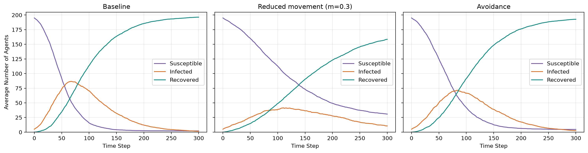
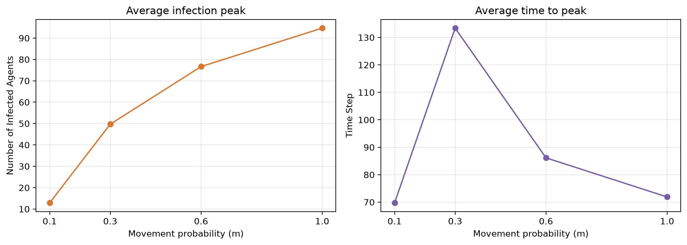
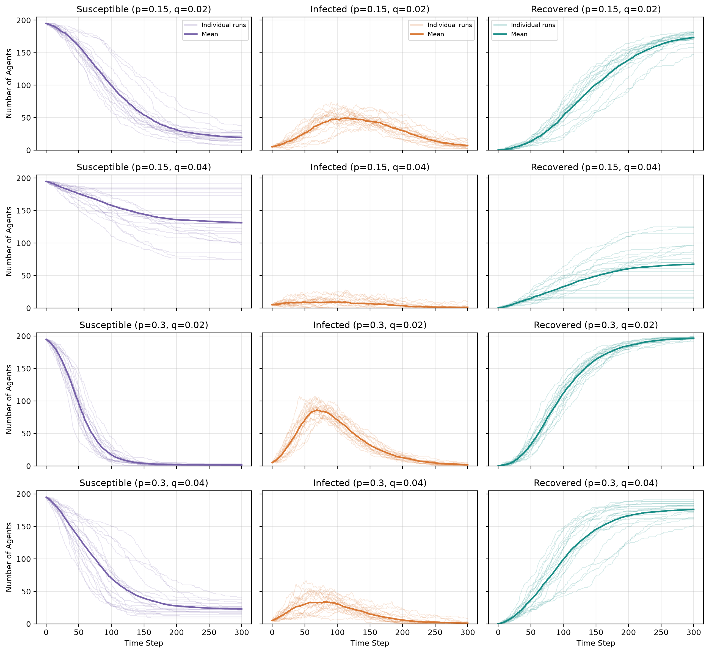
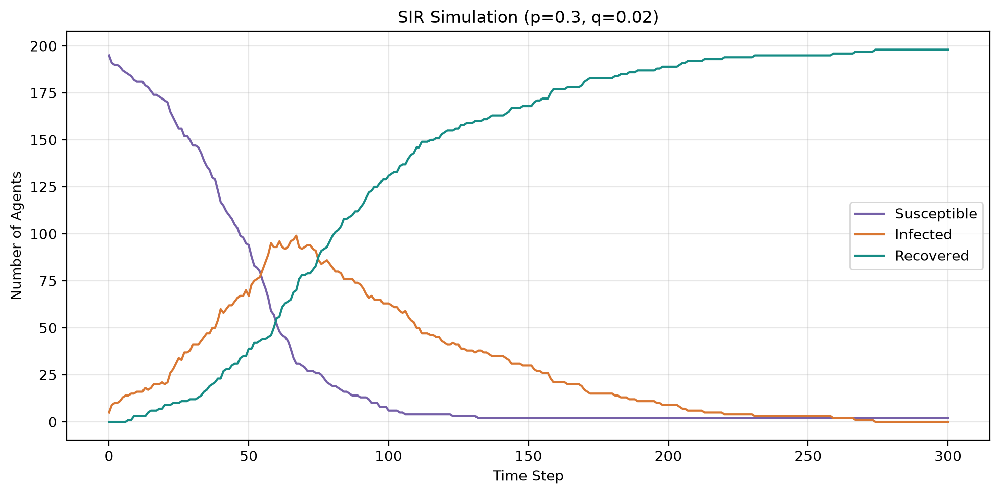
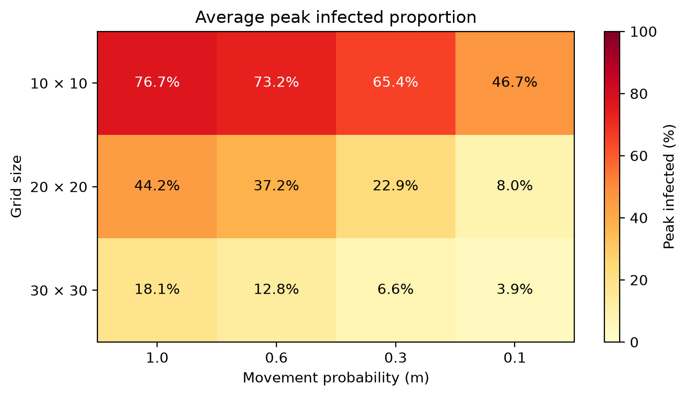
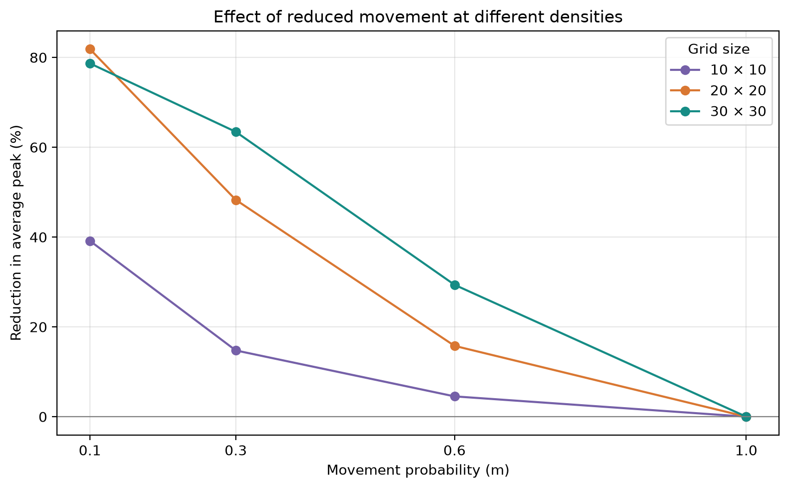

# BMI 500: HW 2: Agent-Based Modeling of Pandemic Spread

- **Name:** Zhu Xu
- **Email:** zhu.xu@emory.edu
- **Question:** HW 2, Lecture 7


## Model and experiments

The initial model consisted of 200 agents on a restricted 20x20 grid: 195 susceptible, 5 infected, and 0 recovered. Cells can be shared by multiple agents. At every step agents randomly select to stay, or to advance up, down, left or right. They cannot move outside the grid.

After movement, a susceptible agent sharing a cell with at least one infected agent becomes infected with probability `p`. This probability stays at `p`, even if several infected agents share the cell. Agents infected at the start of the step recover with probability `q`. State changes happen together, so newly infected agents cannot transmit or recover until the next step. Recovered agents remain immune.

| Experiment | Settings | Runs per setting |
|---|---|---:|
| Part A.iii: base run | `p=0.3`, `q=0.02`, seed 42 | 1 |
| Part A.iv: sensitivity | All combinations of `p=[0.15, 0.3]`, `q=[0.02, 0.04]` | 20 |
| Parts B.i and B.ii: interventions | Baseline, reduced movement (`m=0.3`), avoidance | 20 |
| Part B.iii: distancing strength | `m=[1.0, 0.6, 0.3, 0.1]` | 20 |
| Extension: population density | 10×10, 20×20, 30×30 grids; all four values of `m` | 30 |

Each simulation stops at step 300. Part B and the extension use the same initial counts, with `p=0.3` and `q=0.02`. Part B uses matching seeds to give each strategy identical starting positions. The extension does the same across movement settings at each grid size. Each repeat has a different seed.

The tables report the average maximum infection count and the first time it is reached in each run. “Ever infected” is `200 − S(300)`, including the initial five cases. If infections remain at step 300, the outbreak end time is unknown and the total number ever infected may still increase.


## Results and discussion

### (i) Reducing movement

**Hypothesis:** Reducing movement will lower the infection peak and delay it. Agents will meet fewer new infected individuals, but transmission is still possible in a shared cell.

With `m=0.3`, each agent has a 30% chance of following the original movement rule and otherwise stays. That rule also allows staying, so the probability of changing cells is below 30%. Setting `m=1` restores the Part A movement rule.

With avoidance, susceptible agents choose randomly among their current cell and valid neighboring cells without infected agents. They stay if none are safe. Choices use positions before movement, so an infected agent could still enter the selected cell.

The first three result columns are averages across 20 runs; the last counts completed outbreaks.

| Strategy | Peak infected | Time to peak | Ever infected by 300 | Ended by 300 |
|---|---:|---:|---:|---:|
| Baseline | 94.7 | 71.9 | 197.9 | 6/20 |
| Reduced movement (`m=0.3`) | 49.7 | 133.4 | 169.2 | 0/20 |
| Avoidance | 79.2 | 82.2 | 195.3 | 2/20 |



Reduced movement lowered the average peak by 47.5%, compared with 16.4% for avoidance. None of the reduced-movement outbreaks had ended by step 300. Among completed outbreaks, the mean end times were 281.5 steps for the baseline and 276.0 for avoidance. Most outbreaks were unfinished, so these averages cannot show which strategy ends them sooner.

The next experiment changed `m` while keeping the other settings fixed:

| Movement probability `m` | Mean peak infected | Mean time to peak |
|---|---:|---:|
| 1.0 | 94.7 | 71.9 |
| 0.6 | 76.7 | 86.2 |
| 0.3 | 49.7 | 133.4 |
| 0.1 | 12.9 | 69.8 |



Lower movement gave smaller peaks, but the latest average peak occurred at `m=0.3`, not `m=0.1`. At `m=0.1`, peak times ranged from 0 to 193 steps. Some outbreaks barely grew beyond their initial cases, which brought the average peak time down.

The parameter `m` controls the strength of distancing, while `p` and `q` affect transmission and recovery. Smaller peaks may give hospitals more time to care for patients, although distancing may need to continue longer. Hospital capacity and disease severity are not included in this model.


### (ii) Differences between simulation runs

**Hypothesis:** Random initial positions, movements, infections, and recoveries will produce different outbreaks. Some may die out early, especially with only five initial infections.

| p | q | Mean peak infected | Mean time to peak | Mean ever infected by 300 | Early extinction |
|---|---|---:|---:|---:|---:|
| 0.15 | 0.02 | 58.9 | 120.4 | 180.4 | 0/20 |
| 0.15 | 0.04 | 17.2 | 68.8 | 68.5 | 1/20 |
| 0.30 | 0.02 | 93.8 | 71.0 | 198.4 | 0/20 |
| 0.30 | 0.04 | 44.5 | 86.8 | 177.0 | 0/20 |



At `p=0.15, q=0.04`, some runs infected only 8 agents in total, while others reached 126. Peaks ranged from 5 to 28 agents and occurred at different times, making the average curve flatter than many individual curves.

An outbreak was considered to have died off early if no infected agents remained by step 50. This was observed only once, in the `p=0.15, q=0.04` group. We would need more runs to estimate how common this is.

At both values of `q`, increasing `p` produced larger outbreaks. Increasing `q` reduced the peak and total number infected. Higher `p` pushed the average peak earlier at q=0.02 and later at q=0.04. The notebook also gives standard deviations and ranges. Different seeds therefore baseline averages are slightly different between Part A and Part B.

### (iii) Comparison with the SIR model

**Hypothesis:** The average curves will have a SIR-like shape: susceptible numbers decrease, infections grow and then decrease, and recovered numbers climb. Local contacts may generate deviations from the evenly mixed model.



The base run peaked at 99 infected agents at step 67. By step 300, 198 agents had been infected in total, and the final counts were `S=2, I=0, R=198`. The infection count first reached zero at step 274.

The base run above and the average curves in Part A show the expected SIR pattern. Local contacts and randomness make individual runs less smooth, and some outbreaks stay small. No separate SIR equation model was fitted, so this comparison is about curve shape rather than numerical agreement.


### (iv) Population density (extension)

**Hypothesis:** Higher density will raise the peak of infection . In congested surroundings, reducing movement may be less helpful, as agents can stay in contact if they do not move.

The mean densities for the 200 agents in the 10×10, 20×20, and 30×30 grids are 2.00, 0.50, and ~0.22 agents per cell, respectively. Each grid/movement combination was repeated 30 times.

| Grid | Peak infected at m=1 (%) | Peak infected at m=0.3 (%) | Relative peak reduction at m=0.3 (%) | Ever infected by 300 at m=0.1 (%) |
|---|---:|---:|---:|---:|
| 10×10 | 76.7 | 65.4 | 14.8 | 99.6 |
| 20×20 | 44.2 | 22.9 | 48.3 | 25.4 |
| 30×30 | 18.1 | 6.6 | 63.4 | 7.6 |



Relative peak reduction is `100 × (baseline mean peak − intervention mean peak) / baseline mean peak`, using the `m=1` baseline at the same density.



The most crowded grid had the highest peak at every value of `m`. Moving less helped, but less in the 10×10 grid. Even at `m=0.1`, nearly everyone there had been infected by step 300. Agents sharing a cell can still transmit the infection without moving. This may explain the difference, although repeated contacts were not counted.

At `m=0.1`, the peak decreased by 81.9% in the 20×20 grid and 78.7% in the 30×30 grid. The least crowded grid did not always have the largest relative reduction.

Smaller grids are quicker to cross and have a higher proportion of boundary cells, where outward moves are blocked. The experiment changes spatial mixing as well as density. The 300-step limit may also miss later peaks in unfinished outbreaks.

## Hypothesis revisited

- **Reducing movement: partly supported.** Peaks fell, but the strongest restriction did not delay the average peak.
- **Differences between runs: supported.** Runs varied widely, and one sensitivity run met the early-extinction definition.
- **Similarity to SIR: qualitatively supported.** The average curves followed the expected pattern, with local contacts and randomness affecting individual runs.
- **Population density: generally supported.** Higher density raised peaks, and reduced movement helped less in the most crowded grid. The relative benefit was not strictly ordered by density at every setting.

## Run the notebook

Use **Python 3.12**. From the repository folder:

```bash
python3.12 -m venv .venv
source .venv/bin/activate
python -m pip install --upgrade pip
python -m pip install -r requirements.txt
python -m jupyterlab q2.ipynb
```

## AI statement

Statement: ChatGPT was used to complete this homework. The full chat is available at: https://chatgpt.com/share/6ad1a2cc-b6bc-83ea-9a52-cabe216a9c88.
